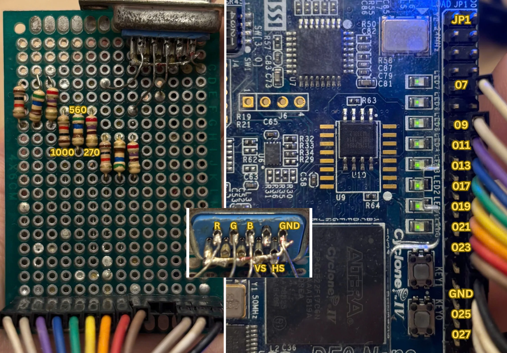

# VGA Controller on DE0-Nano

A simple VGA controller (640×480 @ 60 Hz) written in SystemVerilog for the **Terasic DE0-Nano** board (Intel Cyclone IV E, EP4CE22F17C6).

- **Simulation:** QuestaSim
- **Synthesis & programming:** Quartus Prime Lite

The board offers a clock signal of 50MHz, but a standard 640x460 60Hz VGA monitor requires a speed of about 25.175 millions pixels per second. So i splitted the 50MHz to half, expecting that the monitor could handle the difference of 7% (25MHz vs 25.175MHz).

## Hardware connection

The FPGA drives the monitor through a small adapter board: JP1 header → jumper wires → resistors → DB15 (VGA) connector → monitor.

## Pin assignment

| Signals | Name | FPGA pin | GPIO (JP1 pin) | Wire colour | DB15 pin | Voltage | Description |
|---|---|---|---|---|---|---|---|
| R | Red Video Signal | PIN_A6 | GPIO_011 (16) | Purple | 1 | 0 to +0.72V | Red on/off for current pixel, through 270 Ω |
| G | Green Video Signal | PIN_E6 | GPIO_017 (22) | Green | 2 | 0 to +0.72V | Green on/off for current pixel, through 270 Ω |
| B | Blue Video Signal | PIN_E9 | GPIO_023 (28) | Red | 3 | 0 to +0.72V | Blue on/off for current pixel, through 270 Ω |
| GND | Ground | – | GND (30) | Black | 5 (bridged to 6, 7, 8, 10) | 0V | Common ground between FPGA board and monitor |
| HSYNC | Horizontal Synchronization | PIN_D9 | GPIO_025 (32) | White | 13 | 0 / +3.3V | Negative pulse marks the start of a new line (96 pixels low) |
| VSYNC | Vertical Synchronization | PIN_E10 | GPIO_027 (34) | White | 14 | 0 / +3.3V | Negative pulse marks the start of a new frame (2 lines low) |
| CLK | System Clock | PIN_R8 | – (on-board 50 MHz oscillator) | – | – | +3.3V | 50 MHz clock; 2 clk = 1 pixel (25 MHz) |
| RST_N | Reset (KEY0) | PIN_J15 | – (on-board button) | – | – | +3.3V, active low | Press to reset and show the dog image |
| BTN_N | Switch image (KEY1) | PIN_E1 | – (on-board button) | – | – | +3.3V, active low | Press to toggle between dog and WOOF |

> The 0.72 V colour level comes from the voltage divider between the 270 Ω resistor and the monitor's 75 Ω input: 3.3 × 75 / (270 + 75) ≈ 0.72 V.

## Roadmap

| Phase | Goal | Status |
|---|---|---|
| **Phase 1** | Display static images (rainbow / pride-flag style). Press a button to switch between images. | 🚧 In progress |
| **Phase 2** | Simple animation, using the FPGA's block RAM (BRAM) as a frame buffer. Monochrome is enough, no need for full colour. | ⏳ Planned |
| **Phase 3** | *(If time allows)* Load images from a PC down to the kit and store them in the on-board SDRAM. | ⏳ Planned |

## Phase 1: two static images

The goal of Phase 1 is to show these two images, centred on a black background. Pressing **KEY1** switches between them.

<table>
  <tr>
    <td align="center"></td>
    <td align="center"></td>
  </tr>
  <tr>
    <td align="center"><b>Dog</b>: 240 × 240</td>
    <td align="center"><b>WOOF!</b>: 320 × 240</td>
  </tr>
</table>

### Why these image sizes?

The images are stored inside the FPGA, so they must fit in the on-chip block RAM:

- **BRAM of EP4CE22:** 608,256 bits (66 M9K blocks)
- **Max pixels = BRAM size / bits per pixel**

| Picture size | Bits per pixel | Memory needed | Fits? |
|---|---|---|---|
| 320 × 240 | 8 bit | 614,400 bits | ❌ larger than 608,256 |
| 320 × 240 | 6 bit | 460,800 bits | ✅ |

So the colour depth is lowered to 6 bit and one image is at most 320 × 240. To fit **two** images at the same time:

| Image | Pixels | Bits per pixel | Memory | M9K blocks |
|---|---|---|---|---|
| Dog | 57,600 | 6 | 345,600 bits | 45 |
| WOOF! | 76,800 | 1 | 76,800 bits | 10 |
| **Total** | | | **422,400 bits** | **55 / 66** |

> **Current implementation:** the adapter board only uses the 270 Ω branch, so each colour is 1 bit (8 colours). The Phase 1 RTL (`rtl/vga_phase1.sv`) therefore stores both images as 3 bit per pixel (`*_3bit.list`): 172,800 + 230,400 = **403,200 bits**.
